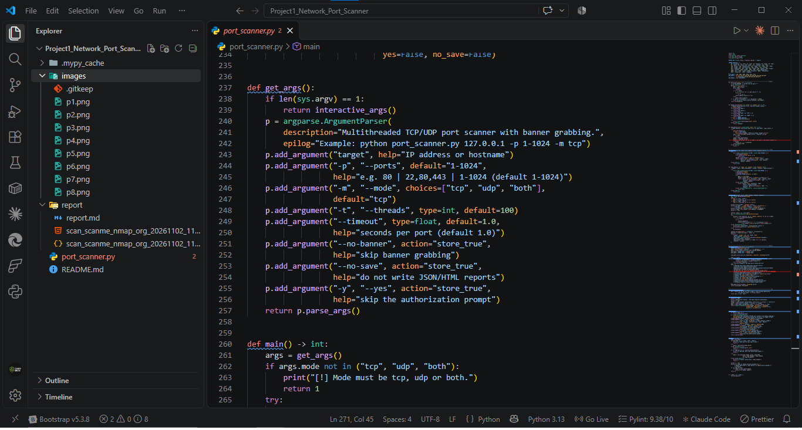
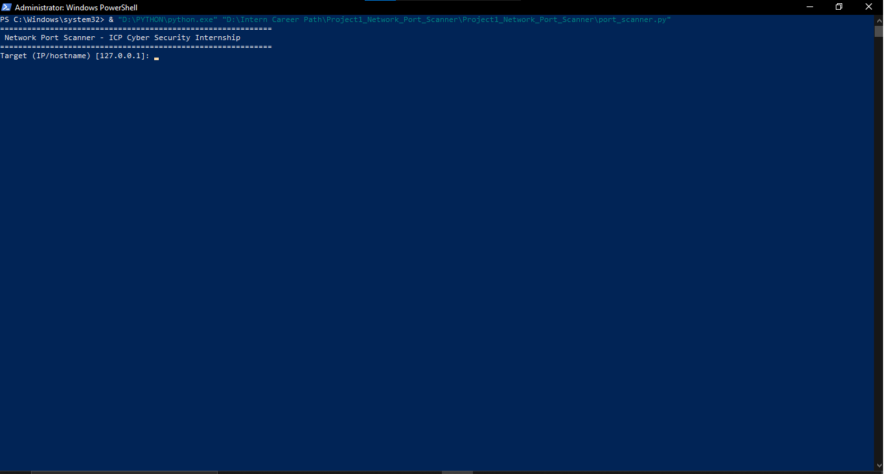
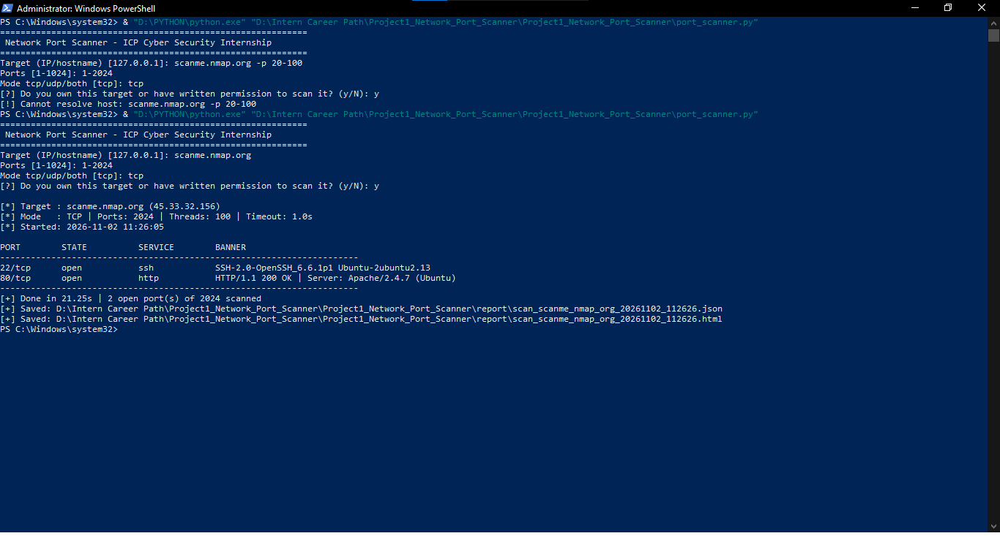
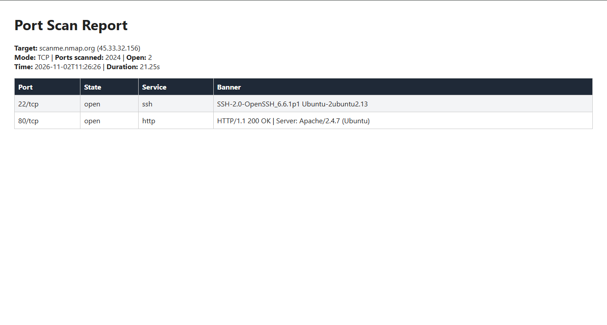
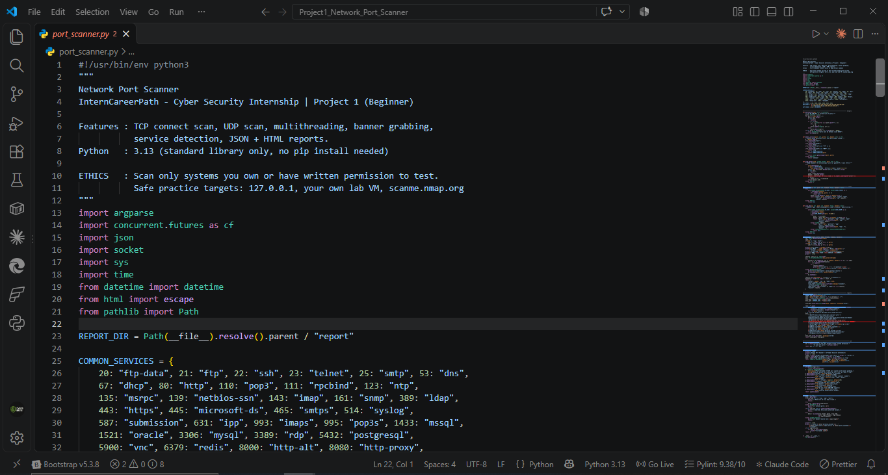
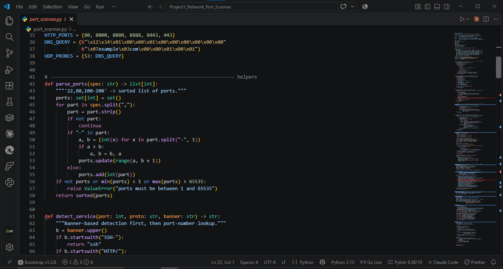
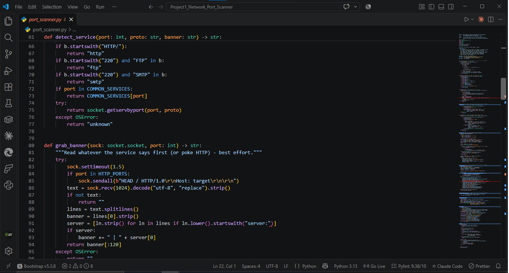
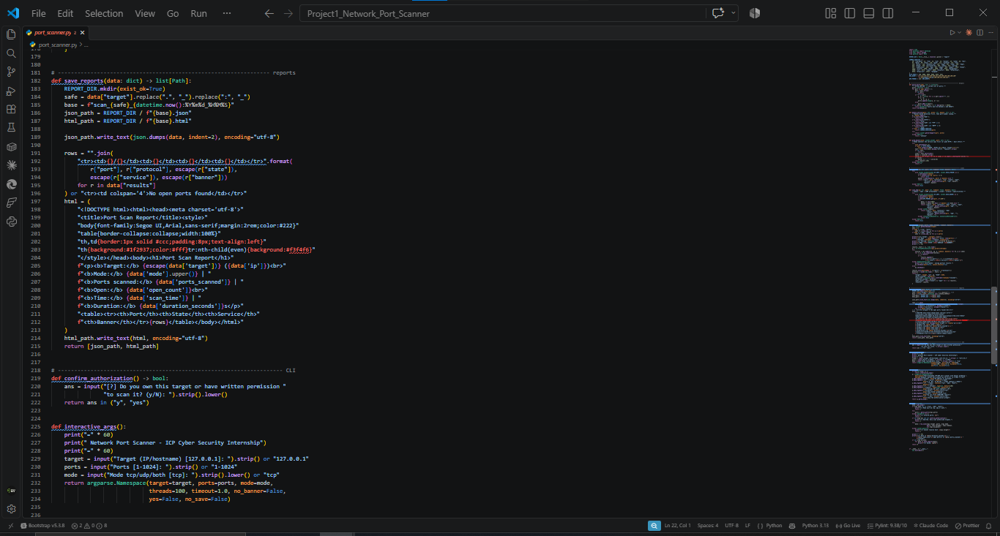
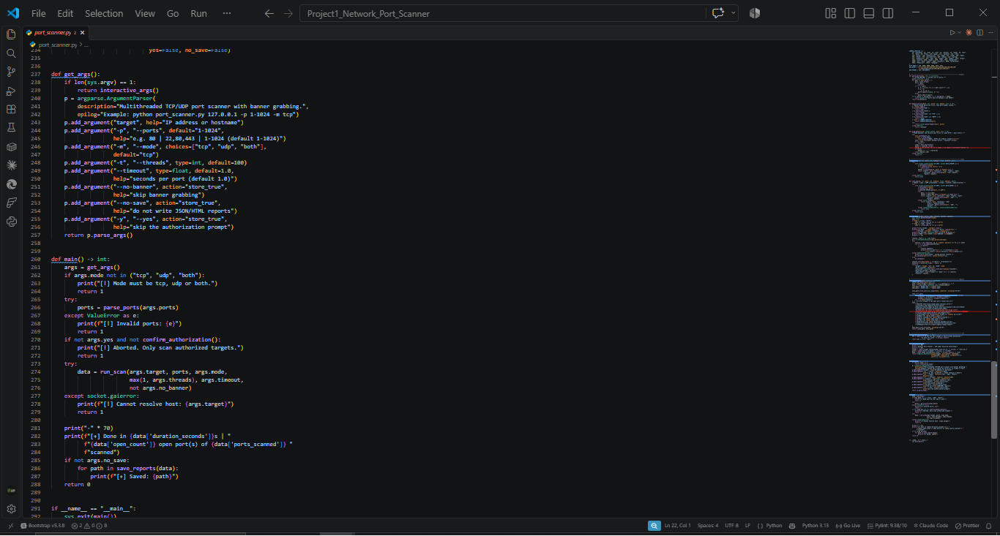

# Project 1: Network Port Scanner

**InternCareerPath | Cyber Security Self-Learning Internship | Difficulty: Beginner**

A multithreaded TCP/UDP port scanner written in pure Python 3.13 (standard library only, no `pip install`). It finds open ports, grabs service banners, identifies the service, and saves JSON and HTML reports.

> **Ethics:** scan only systems you own or have written permission to test. Practice targets used here: `127.0.0.1`, your own lab VM, and `scanme.nmap.org` (Nmap allows scanning it).

## Features

- TCP connect scan and UDP scan (`tcp`, `udp`, `both` modes)
- Multithreading (default 100 threads) for fast scans
- Banner grabbing (SSH banner, HTTP `Server:` header)
- Service detection from the banner first, then port number
- Flexible port input: `80`, `22,80,443`, `1-1024`
- Interactive mode and full CLI (`argparse`)
- Authorization prompt before every scan
- Auto-saved JSON and HTML reports in `report/`

## Project Structure

```
Project1_Network_Port_Scanner/
├── port_scanner.py      # main program
├── README.md
├── images/              # screenshots used in README and report
└── report/
    ├── report.md        # full project report
    └── scan_*.json/.html  # generated scan outputs
```



## Requirements

- Python 3.13 (works on 3.9+). No external libraries.

## Usage

**Interactive mode** (no arguments):

```
python port_scanner.py
```



**CLI mode:**

```
python port_scanner.py <target> [-p PORTS] [-m tcp|udp|both] [-t THREADS] [--timeout SEC] [--no-banner] [--no-save] [-y]
```

| Option | Description | Default |
|--------|-------------|---------|
| `target` | IP address or hostname | required |
| `-p, --ports` | Ports, e.g. `80`, `22,80,443`, `1-1024` | `1-1024` |
| `-m, --mode` | `tcp`, `udp` or `both` | `tcp` |
| `-t, --threads` | Number of threads | `100` |
| `--timeout` | Seconds per port | `1.0` |
| `--no-banner` | Skip banner grabbing | off |
| `--no-save` | Do not write reports | off |
| `-y, --yes` | Skip authorization prompt | off |

Examples:

```
python port_scanner.py 127.0.0.1 -p 1-1024
python port_scanner.py scanme.nmap.org -p 1-1024 -y
python port_scanner.py 127.0.0.1 -p 50-60 -m udp
```

## Sample Run

Scan of `scanme.nmap.org` (45.33.32.156), TCP, ports 1-2024, 100 threads:



Result: 2 open ports out of 2024 in 21.25 s.

| Port | State | Service | Banner |
|------|-------|---------|--------|
| 22/tcp | open | ssh | SSH-2.0-OpenSSH_6.6.1p1 Ubuntu-2ubuntu2.13 |
| 80/tcp | open | http | HTTP/1.1 200 OK \| Server: Apache/2.4.7 (Ubuntu) |

## HTML Report

Every scan also writes a `.json` and a styled `.html` report into `report/`.



## Code Walkthrough

| Part | Screenshot |
|------|------------|
| Imports, constants, service table |  |
| Port parsing, HTTP ports, DNS probe |  |
| Service detection and banner grabbing |  |
| Report generation and interactive mode |  |
| Argument parser and `main()` |  |

## What I Learned

- How the TCP handshake decides open vs closed ports
- Why UDP scanning is slower and less certain (`open|filtered`)
- Python sockets, timeouts and `ThreadPoolExecutor`
- Banner grabbing and basic service fingerprinting
- Generating machine-readable (JSON) and human-readable (HTML) reports
- Scanning ethics and authorization

See the full write-up in [report/report.md](report/report.md).
