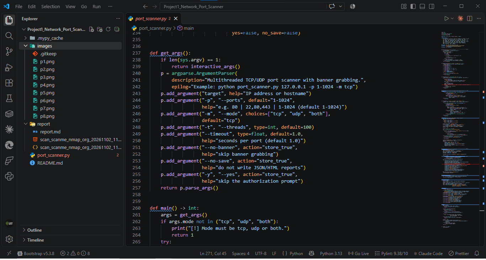
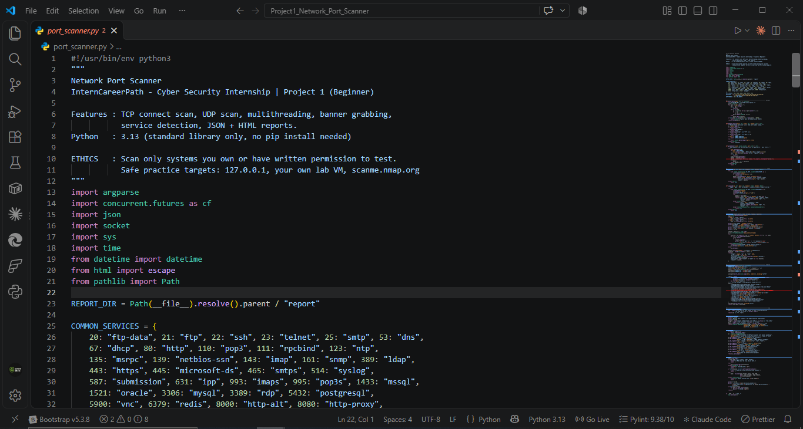
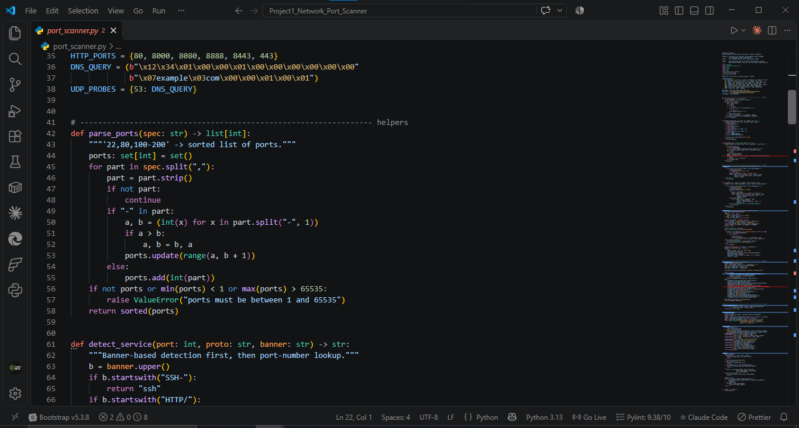
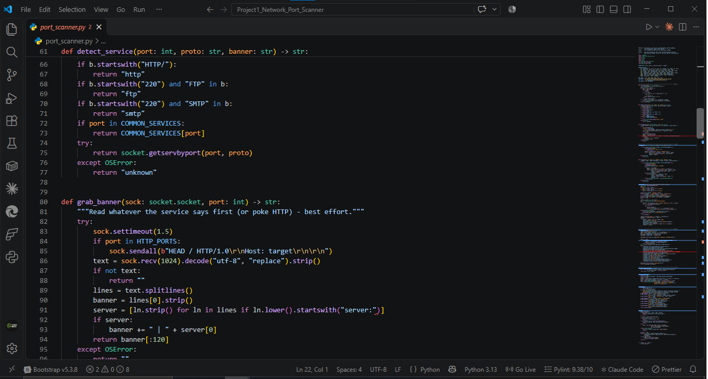
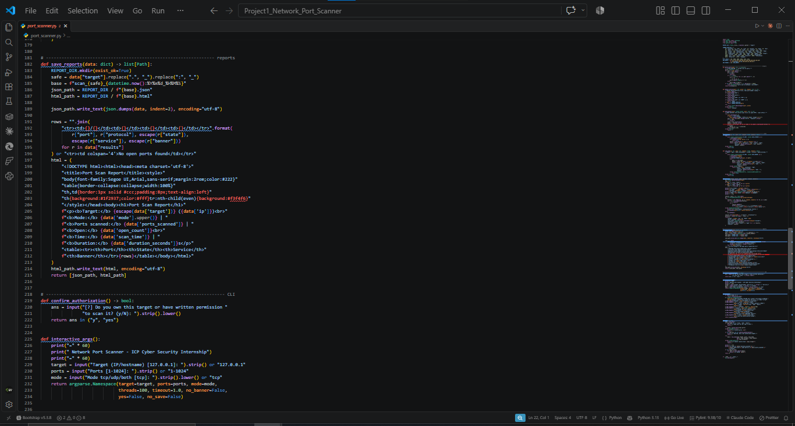
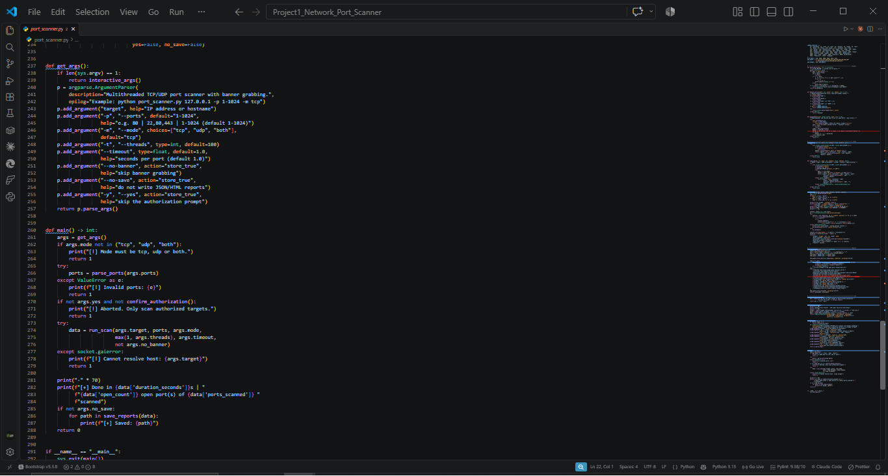
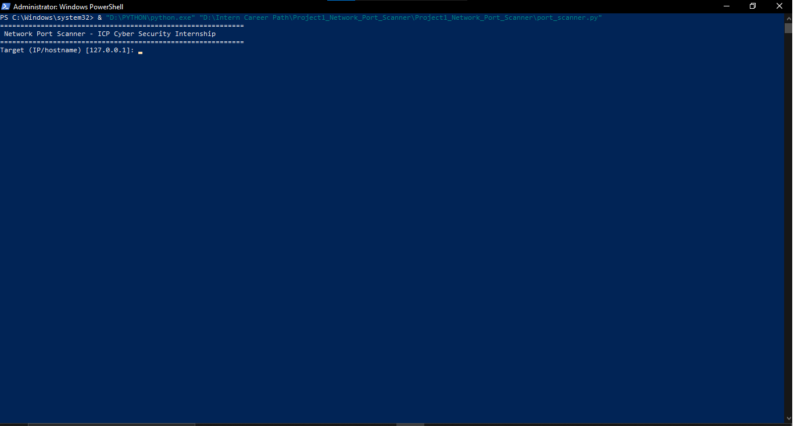
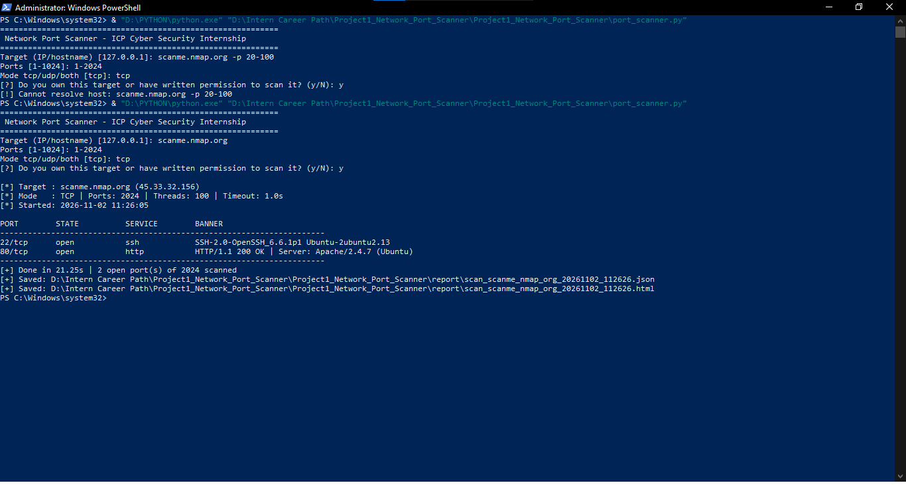
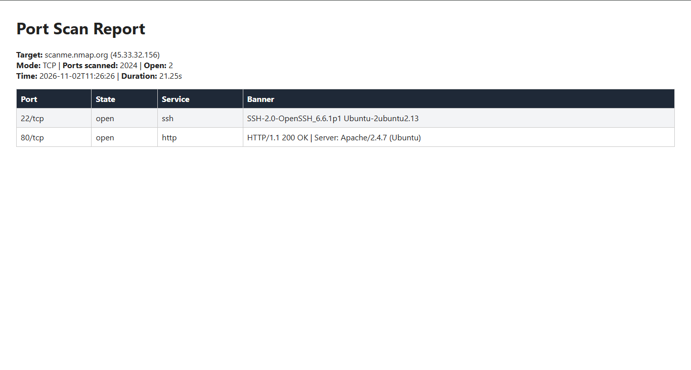

# Project 1 Report: Network Port Scanner

**Program:** InternCareerPath Cyber Security Self-Learning Internship
**Project:** 1 of 2+ (Beginner)
**Portal ID:** ICP-896E95A4-2026
**Language / Version:** Python 3.13 (standard library only)

---

## 1. Objective

Build a tool that identifies open ports on a target and the services running on them. Real-world problem: administrators, attackers and SOC analysts all need to know which services a host exposes.

## 2. Background

A port is a numbered entry point to a service on a host. Scanning checks which ports respond.

- **TCP connect scan:** a full 3-way handshake (SYN, SYN/ACK, ACK). If it completes, the port is **open**.
- **UDP scan:** UDP has no handshake. A reply means open, an ICMP "port unreachable" means closed, and silence means **open|filtered**.
- **Banner grabbing:** reading the first data a service sends, or its reply to a simple request, to learn the software and version.

## 3. Lab Environment

| Item | Value |
|------|-------|
| OS | Windows (PowerShell, run as Administrator) |
| Editor | Visual Studio Code |
| Python | 3.13 |
| Libraries | Standard library only: `socket`, `concurrent.futures`, `argparse`, `json`, `pathlib`, `html`, `datetime` |
| Authorized target | `scanme.nmap.org` (45.33.32.156), provided by the Nmap project for scan testing |

## 4. Project Structure

```
Project1_Network_Port_Scanner/
├── port_scanner.py
├── README.md
├── images/
└── report/
    ├── report.md
    └── scan_scanme_nmap_org_20261102_112626.json / .html
```



## 5. Design and Implementation

### 5.1 Configuration and constants
A dictionary of common services, the set of HTTP ports that need a probe, and a DNS query used as the UDP probe for port 53.



### 5.2 Port parsing
`parse_ports()` accepts single ports, comma lists and ranges (`22,80,100-200`), removes duplicates, sorts them, and rejects values outside 1-65535.



### 5.3 Service detection and banner grabbing
- `detect_service()` checks the banner first (`SSH-`, `HTTP/`, FTP/SMTP greetings), then the known-ports table, then the OS services database.
- `grab_banner()` sends `HEAD / HTTP/1.0` to HTTP ports, reads up to 1024 bytes, and keeps the first line plus the `Server:` header. Errors are caught so a silent service never crashes the scan.



### 5.4 Scanning engine
- `scan_tcp()` uses `connect_ex()`; return code `0` means open.
- `scan_udp()` connects a UDP socket, sends a probe, and classifies the result as open, closed, or `open|filtered`.
- `run_scan()` runs all ports through a `ThreadPoolExecutor` (100 workers by default), prints open ports as they are found, and handles `Ctrl+C` by saving partial results.

### 5.5 Reporting and interactive mode
`save_reports()` writes a JSON file and a styled HTML table into `report/`. `interactive_args()` prompts for target, ports and mode when the program is started without arguments.



### 5.6 CLI and main flow
`argparse` provides the options below. `main()` validates input, asks for authorization, runs the scan, prints a summary, and returns a proper exit code.

| Option | Purpose |
|--------|---------|
| `-p` | ports (default `1-1024`) |
| `-m` | `tcp`, `udp`, `both` |
| `-t` | thread count |
| `--timeout` | seconds per port |
| `--no-banner` | skip banners |
| `--no-save` | skip reports |
| `-y` | skip authorization prompt |



## 6. Testing and Results

### 6.1 Interactive mode
The program starts in interactive mode and prompts for the target.



### 6.2 Scan of scanme.nmap.org

| Setting | Value |
|---------|-------|
| Target | scanme.nmap.org (45.33.32.156) |
| Mode | TCP |
| Ports scanned | 2024 (range 1-2024) |
| Threads / Timeout | 100 / 1.0 s |
| Duration | 21.25 s |
| Open ports | 2 |

| Port | State | Service | Banner |
|------|-------|---------|--------|
| 22/tcp | open | ssh | SSH-2.0-OpenSSH_6.6.1p1 Ubuntu-2ubuntu2.13 |
| 80/tcp | open | http | HTTP/1.1 200 OK \| Server: Apache/2.4.7 (Ubuntu) |



**Error handling check:** in the first attempt the full command text (`scanme.nmap.org -p 20-100`) was typed into the *Target* prompt. The tool did not crash. It printed `[!] Cannot resolve host` and exited cleanly. The second attempt, with only the hostname, succeeded.

### 6.3 HTML report
The generated report shows the target, mode, ports scanned, open count, time, duration and a results table.



## 7. Analysis

- The scan took 21.25 s for 2024 ports. Most ports were filtered (no reply), so each one waited for the 1 s timeout. With 100 threads that is about 20 rounds of 1 s. A shorter `--timeout` would speed this up at the cost of missing slow hosts.
- The banners reveal software versions: OpenSSH 6.6.1p1 and Apache 2.4.7 on Ubuntu. These are old releases (around 2014). On a real engagement, version disclosure like this is the first step of vulnerability research. `scanme.nmap.org` is intentionally left this way for testing.
- From a **SOC** view, a scan like this shows up as many connection attempts from one source to many ports in a short time, a classic pattern for detection rules.

## 8. Challenges and Limitations

- **UDP accuracy:** most UDP services stay silent, so results are mostly `open|filtered`. UDP mode is implemented but was not captured in the screenshots, so no UDP results are claimed in this report.
- **Banner detection** covers common protocols only, and TLS services (e.g. 443) need a TLS handshake to return useful data.
- **Connect scan only:** it completes the handshake, so it is easily logged by the target. It cannot do stealth (SYN) scanning, which needs raw sockets (Scapy/Nmap).
- **IPv4 only.**
- **Not compared with Nmap:** results were not validated side by side with Nmap in this run.

## 9. Possible Improvements

- Nmap comparison for validation
- SYN scan with Scapy
- TLS banner grabbing
- IPv6 support
- Output to CSV
- Top-100 ports shortcut

## 10. Conclusion

The scanner meets the project requirement: it identifies open ports and services using only the standard library. It correctly found SSH and HTTP on the practice target, reported their software versions, handled bad input without crashing, and produced JSON and HTML reports. Key skills gained: sockets, TCP/UDP behaviour, multithreading, banner grabbing, report generation, and ethical scanning.

## 11. Ethics Statement

All scans were performed only on `scanme.nmap.org`, a host that Nmap explicitly allows for scan testing. The tool asks for authorization confirmation before every scan.
